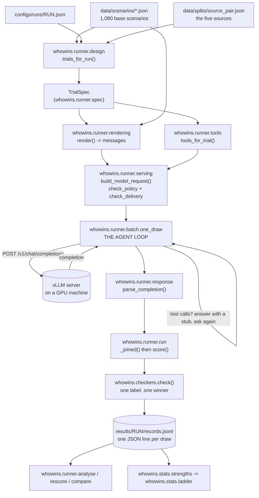

# 00 — Overview: the whole system in one sitting

This folder is a code-level companion to the repository. The [README](../../README.md) says what the
study asks and what it found. These files describe what the code does, file by file, including how the
files call each other.

Read in order:

| File | What it covers |
|---|---|
| [00_overview.md](00_overview.md) | This file: the mental model, the pipeline, the package map |
| [01_research_design.md](01_research_design.md) | The question, the choice model, why the design looks like this |
| [02_data_collection.md](02_data_collection.md) | `data/`: scenarios, worked trials, splits, on-disk shapes |
| [03_validation.md](03_validation.md) | `src/whowins/validation/`: the screens over the collection |
| [04_checkers.md](04_checkers.md) | `src/whowins/checkers/`: how a reply becomes one label |
| [05_splits.md](05_splits.md) | `src/whowins/splits/`: the frozen held-out lists |
| [06_runner_spec_and_rendering.md](06_runner_spec_and_rendering.md) | `spec.py`, `vocabulary.py`, `rendering.py`, `trials.py` |
| [07_runner_design.md](07_runner_design.md) | `design.py`: how a run's trial list is built |
| [08_serving_and_configs.md](08_serving_and_configs.md) | `configs/` and `serving.py`: models, machines, policies, runs |
| [09_runner_execution.md](09_runner_execution.md) | `tools.py`, `response.py`, `run.py`, `batch.py`, `preflight.py`, `fillers.py` |
| [10_reading_results.md](10_reading_results.md) | `analyse.py`, `rescore.py`, `compare.py`, `results/`, logging |
| [11_statistics.md](11_statistics.md) | `src/whowins/stats/`: the fit, the nulls, the ladder, the gate |
| [12_tests.md](12_tests.md) | `tests/`: what is pinned and how |
| [14_glossary.md](14_glossary.md) | Every term this repository uses in its own way |
| [15_statistics_alternatives.md](15_statistics_alternatives.md) | The alternatives to Plackett-Luce, regularity, capacity, and random effects |
| [16_load_bundles_and_tiers.md](16_load_bundles_and_tiers.md) | The load bundles, their validator, and the declared-tier design |
| [17_layouts.md](17_layouts.md) | The operator, one-message and realism designs, the realism set, and tiers 1 to 6 |

---

## 1. The question

An AI agent reads instructions from several places at once: the operator's system prompt, a
config file, the user's message, a tool result, its own saved note. When two of them disagree,
which one does the model follow? Existing benchmarks answer that for **pairs**, but deployments
run **many** sources at once. This repository asks whether the pairwise answer **composes**: if
you measure A-beats-B for every pair, can you predict what happens when three or five sources
compete?

Either answer is useful. If it composes, cheap two-way measurements become a real tool. If it
does not, every pairwise hierarchy benchmark certifies less than it claims. There is a proof that
pairwise data alone *cannot* settle the question, which is why three-way data is collected from
the start.

## 2. The two-level data model

The most important idea in the repository is one separation:

```
 A BASE SCENARIO  (data/scenarios/…)          A TRIAL  (built by whowins.runner.design)
 ─────────────────────────────────            ──────────────────────────────────────
 content only:                                one thing you send to a model:
   • a task                                     • a base scenario
   • 5 mutually exclusive instructions           • which options are in play
     ("use snake_case", "use camelCase", …)      • which SOURCE carries each one
   • one deterministic checker per option        • where each source sits in the prompt
                                                 • how each source is labelled
 says NOTHING about where an                    • which renderer serializes it
 instruction came from
```

A scenario is *what the model is asked to decide*. A trial is *how the disagreement is staged*.
One scenario produces many trials, and between two trials exactly one factor moves. Transport
role, displayed provenance, declared rank, position and surface are **never** fields on a
scenario. Putting them there would merge the two levels, and then no comparison between trials
could isolate a single factor.

The five **sources** are frozen in `data/splits/source_pair.json`:

| id | transport role | displayed provenance |
|---|---|---|
| `S1` | system | operator policy |
| `S2` | developer (rides the operator channel) | repository config |
| `S3` | user | user message |
| `S4` | tool | tool result |
| `S5` | user | memory note |

## 3. The pipeline, end to end



In one sentence: a scenario plus a design becomes a trial, a trial plus a chat format becomes
messages, messages sent to a server come back as completions, the checkers turn the completions
into one row of an append-only log, and the log is then read into a report, rescored, compared
with other runs, or fitted.

`whowins.runner.batch` is the only module that opens a socket. Everything else is pure, and it is
verified offline against a stub server, a fake `vllm` command and a fake `nvidia-smi`.

Reading a log back uses the same code that scored it. `whowins.runner.run.answer_text(row)` parses
every stored turn the way `score()` did and picks the turn `_joined()` picks, so `analyse`
diagnoses the text the checker actually read.

## 4. The package map

```
src/whowins/
├── data.py          one JSON reader that names the file when it fails; ROOT, and a clear
│                    error when ROOT/data is missing (an installed copy, not a checkout)
├── logs.py          logging to stderr + logs/<tool>-<subject>-<when>.log. NEVER stdout
├── progress.py      a dependency-free progress bar on stderr
│
├── validation/      READ-ONLY screens over the collection
│   ├── check_batch.py          cross-cutting screens (schema, exclusivity, duplication, …)
│   ├── validate_collection.py  per-family invariants, counts, trial integrity
│   ├── check_load.py           every load bundle: the grid, the lines, the token lengths
│   ├── check_realism.py        every realism batch: slots, lengths, nothing that steers
│   └── build_registry.py       regenerates data/REGISTRY.md (the one script that writes)
│
├── checkers/        a reply -> one label -> at most one winning option
│   ├── __init__.py  check(), and fingerprint(): a hash of the scoring source
│   ├── core.py      Response, ToolCall, Outcome, the registry, the two outcome axes,
│   │                the "talk is not an artifact" gate, the two-answers detector
│   ├── trace.py     the 4 trace keys (840 scenarios): first_tool_call, write_target,
│   │                step_order, decision
│   ├── coverage.py  which scenarios are executable (1,080 / 1,080)
│   └── fmt/         the 240 format classifiers, grouped by axis
│       ├── _lib.py  spec()/fn_spec()/uniform_spec(), artifact_text(), unwrap()
│       └── surface, wire, editorial, syntax, values, tooling, prose, domain, structural
│
├── splits/          frozen train/val/test and fold lists, a pre-registration commitment
│   ├── grouping.py  three measured link rules (seed_family does NOT group)
│   ├── axes.py      which constraint axis each scenario measures
│   ├── sources.py   the five sources, derived from the worked trials
│   ├── build.py     WRITES data/splits/*.json; run once, committed
│   └── check.py     verifies the files on disk against the rules that made them
│
├── runner/          scenario -> messages -> server -> score
│   ├── vocabulary.py every literal string a rendered trial may contain
│   ├── spec.py       TrialSpec, Span, Block, Message, Task, ConflictGroup + invariants
│   ├── rendering.py  the three renderers: plain_chat, xml_wrapped, json_envelope
│   ├── trials.py     reads the 70 hand-written trials back as specs (the renderer's spec)
│   ├── design.py     builds a run's trial list: pairwise, ladders, free predictions, load
│   │                 bundles, declared tiers
│   ├── bundles.py    reads the hand-written load bundles in data/load/ as trials
│   ├── layouts.py    the operator, one-message and realism designs, each paired within the item
│   ├── tools.py      the tool schemas a scenario's checker can read an answer from
│   ├── fillers.py    the load cell's filler lines: kinds, and code that scores each one
│   ├── serving.py    the roster, the machines, the policies, the runs, the delivery guard
│   ├── preflight.py  checks a live server against its environment's pins
│   ├── response.py   completion envelope -> Response; reasoning splitting
│   ├── run.py        build_request, score, answer_text, RunRecord, ServingStack, Decoding
│   ├── batch.py      THE RUN LOOP. The only module that opens a socket
│   ├── rescore.py    score a finished run again, offline
│   ├── analyse.py    what a run did: counts, proportions, Wilson intervals
│   └── compare.py    two or more run reports side by side
│
└── stats/           phase 1: the fit, the families, capacity, the simulation that gates them
    ├── choice.py    Choice/Option/Dataset; from_records(); kinds(); canonical()
    ├── models.py    conditional logit: uniform, position, luce, luce_position,
    │                luce_position_size, context(_position), saturated; a second MM fitter
    ├── families.py  independent Thurstone and the correlated probit, normal errors
    ├── normal.py    the normal CDF, the bivariate normal, orthants above two dimensions
    ├── score.py     held-out log score, Brier, calibration, item-clustered bootstrap
    ├── rankings.py  RankingWorld; the exact pairwise-insufficiency counterexample
    ├── simulate.py  planted truths and data drawn from them
    ├── power.py     power curves from simulation
    ├── ladder.py    the two-stage composition test, read off data/splits/set.json
    ├── regularity.py does adding a competitor ever raise an option's share?
    ├── capacity.py  R(q) on declared tiers, lower and upper bound; reads a tier run
    ├── load_cell.py load versus conflict, per trial and paired over bundles; reads a load run
    ├── layouts.py   the three layout designs read back, paired within the item
    ├── paired.py    a rate over replicate units and a paired difference, with their intervals
    ├── mixed.py     random effects: item tastes, family shifts
    ├── pooled.py    one fit across runs: model and, where separable, harness shifts
    ├── strengths.py fits a real run, and runs the composition test when it can
    └── phase1.py    the gate: 23 checks with a PASS/FAIL verdict
```

## 5. Entry points

Every command is a `python3 -m` module. The shell scripts only set `PYTHONPATH` and pass their
arguments through.

| Script | Module | What it does | Needs a GPU? |
|---|---|---|---|
| `scripts/create_env.sh` | `whowins.runner.serving env` | build a machine's conda environment | no |
| `scripts/download_models.sh` | `whowins.runner.serving download` | fetch pinned weights | no |
| `scripts/serve.sh` | `whowins.runner.serving shell`/`gpus` | start vLLM on free cards | **yes** |
| `scripts/preflight.sh` | `whowins.runner.preflight` | check a live server against its pins | server host |
| `scripts/design.sh` | `whowins.runner.design` | what a run would send, and how evenly | no |
| `scripts/run_trials.sh` | `whowins.runner.batch` | send a run, score every reply, resume | **yes** |
| `scripts/rescore.sh` | `whowins.runner.rescore` | re-score replies already on disk | no |
| `scripts/analyse.sh` | `whowins.runner.analyse` | what one run did | no |
| `scripts/compare.sh` | `whowins.runner.compare` | two or more runs side by side | no |
| `scripts/strengths.sh` | `whowins.stats.strengths` | fit a strength per source to a run; the composition test on a run with sets above a pair | no |
| `scripts/phase1.sh` | `whowins.stats.phase1` | the simulated statistics gate | no |
| `scripts/capacity.sh` | `whowins.stats.capacity` | R(q) on declared tiers, from a `declared-tiers` run | no |
| `scripts/load_cell.sh` | `whowins.stats.load_cell` | load versus conflict, from a `load-bundles` run | no |
| `scripts/layouts.sh` | `whowins.stats.layouts` | the operator test, the one-message test or the realism set, from its run | no |
| `scripts/pool.sh` | `whowins.stats.pooled` | one fit across runs, with model and harness shifts | no |
| `scripts/run_main.sh` | `scripts/run_trials.sh` per run | every main run of one served model | **yes** |
| — | `whowins.validation.check_batch` | cross-cutting screens | no |
| — | `whowins.validation.validate_collection` | family invariants | no |
| — | `whowins.validation.build_registry` | regenerate `data/REGISTRY.md` | no |
| — | `whowins.validation.check_load` | is every load bundle fit to send? | no |
| — | `whowins.checkers.coverage` | how many scenarios are executable | no |
| — | `whowins.splits.check` | are the frozen splits still true? | no |
| — | `whowins.splits.build` | **rewrites** the five frozen lists | no |
| — | `whowins.runner.serving check` | do all the configs agree? | no |

The full command sequence, with every flag, is in [`runbook.md`](../../runbook.md).

## 6. Where state lives

```
 SOURCE OF TRUTH                       DERIVED, REGENERABLE            APPEND-ONLY EVIDENCE
 ─────────────────────                 ─────────────────────           ────────────────────
 data/scenarios/*.json                 data/REGISTRY.md (gitignored)   results/<run>/records.jsonl
 data/trials/*.json                    results/<run>/summary.json
 data/splits/*.json  (frozen)          results/<run>/rescored.jsonl    logs/*.log (gitignored)
 configs/*.json, configs/vllm/*.yaml     (gitignored)
 src/**, tests/**
```

The code enforces three rules that follow from this layout:

1. **`records.jsonl` is never rewritten.** A rescore writes a second file beside it, and a retry
   appends a second attempt. Both rows stay.
2. **The split lists are a commitment.** `whowins.splits.build` warns that it is overwriting five
   frozen files, and `whowins.splits.check` fails a list that no longer matches the collection
   fingerprint it was built from.
3. **stdout is a contract.** A shell script `eval`s the output of `serving shell KEY`,
   `serving gpus` is substituted into a command line, and `batch --report` prints JSON. Every log
   line and every progress bar therefore goes to stderr.

## 7. Three rules that explain most of the code's shape

**A checker never guesses.** It returns `UNRESOLVED` instead of a best label, and an
unimplemented key raises `UnknownCheckerKey` instead of scoring as a model failure. A guessed
label turns a model failure into a false win for whichever option was guessed, which is worse
than having no measurement.

**What the model sees must be what the record says.** Both serving engines rewrite some
conversations without reporting it, and each rewrites them differently. vLLM 0.28.0 renames a
`developer` message and merges it into the first system message. vLLM 0.8.5 renames nothing, and
Qwen 3's chat template then drops the message without an error. So every request goes through
`build_model_request`, which rejects anything the chat format would change, and every draw states
every sampling setting.

**A machine is part of the experiment.** There are two machines, two engine versions and two
number formats. Every model names its environment, and every record carries a `ServingStack`
fingerprint. A claim about what an engine does is kept in `ENGINE_PROFILES` in code, read out of
that version's source. It is never a config field, because a config field would let anyone
declare a behaviour nobody checked.

## 8. What exists, and what does not

| | Status |
|---|---|
| 1,080 hand-written base scenarios, 5 families | done, 0 FAIL, 100% executable |
| 70 worked trials in 7 experiment cells | done; all 70 re-render byte for byte |
| 240 format classifiers + 4 trace checkers | done, 1,382 adversarial fixtures |
| Five frozen split lists | done |
| Renderer + delivery guard + agent loop + run loop | done, end to end |
| Four test runs sent (1 rotation, 2 balanced, 1 ladder) | done, all exploratory. Their records are not part of this repository |
| Statistics phase 1: fit, nulls, simulation gate | done, 23/23 checks pass |
| The composition test on real data | run once, on `ladder-qwen3-14b` |
| Thurstone, correlated probit, context (pair-interaction) families; regularity | done |
| Random effects: item, family, model; harness where separable | done; the main run cannot separate a harness from its models |
| Load bundles | nine hand-written replicates of the load cell, each passing `check_load`; `scripts/load_cell.sh` reads a load run, and no load run has been sent |
| Declared-tier design and capacity from a run | built, tiers 1 to 6 in the main run; no tier run has been sent |
| Operator, one-message and realism designs | built; the realism set's 50 items written, reviewed and passing `check_realism` |
| The main run | configured: 196 configs, seven kinds per model and mode, sent in priority order; and fourteen copies of the Qwen 3 32B's runs for the 80 GB cards |
| Pre-registration | **none, by decision** (2026-09-29): every run is exploratory |
| ARBITER | **no code**, demoted to an appendix |

## 9. The shortest useful loop for a newcomer

```bash
python3 -m pytest -q tests/                        # 2,387 tests (4 skipped), ~2.5 min
python3 src/whowins/validation/check_batch.py          # 0 FAIL, 125 warn
PYTHONPATH=src python3 -m whowins.splits.check         # 0 FAIL
PYTHONPATH=src python3 -m whowins.runner.serving check # configs agree
PYTHONPATH=src python3 -m whowins.validation.check_load   # 9 bundles, 0 FAIL
PYTHONPATH=src python3 -m whowins.validation.check_realism   # every realism batch on disk, 0 FAIL
PYTHONPATH=src python3 -m whowins.runner.design ladder-qwen3-14b --balance
PYTHONPATH=src python3 -m whowins.stats.phase1
```

None of these needs a GPU or a network. To read a real run you need its records, which are not part
of this repository. Given the records of `ladder-qwen3-14b` under `results/`, `analyse ladder-qwen3-14b` will
report that its records were scored by older checkers than the ones installed, and
`scripts/rescore.sh ladder-qwen3-14b --write` produces a rescored copy to analyse instead.
