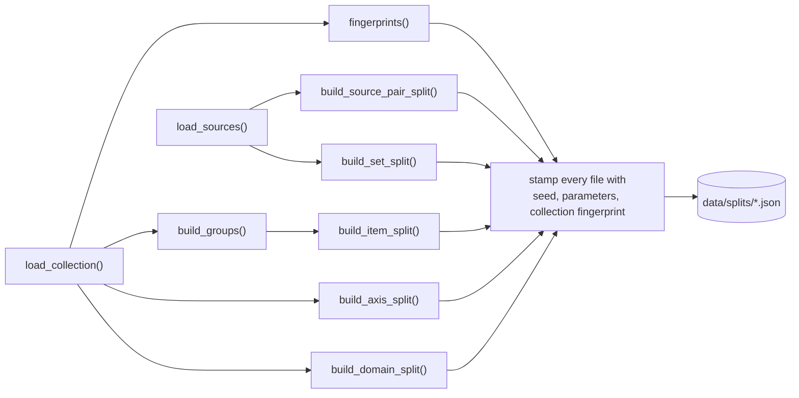

# 05 — `src/whowins/splits/`: the frozen held-out lists

A split list says which scenarios may be fitted on and which are held back. It is a
**pre-registration commitment**: built once, committed, and never rebuilt to suit a result.
`build.py` is the only module that writes, and `check.py` verifies the files on disk against the
rules that made them.

```
splits/
├── grouping.py   when are two scenarios too alike to sit on opposite sides?
├── axes.py       which kind of constraint each scenario measures
├── sources.py    the five sources, and the sets they form
├── build.py      WRITES data/splits/*.json
└── check.py      16 checks over the five files; READ-ONLY
```

```bash
PYTHONPATH=src python3 -m whowins.splits.check            # 0 FAIL today
PYTHONPATH=src python3 -m whowins.splits.check --exclude fmt-0034 fmt-0052   # what an exclusion would cost
PYTHONPATH=src python3 -m whowins.splits.build --dry-run  # read the summary first
PYTHONPATH=src python3 -m whowins.splits.build            # rewrites five frozen files
```

---

## 1. Why grouping by `seed_family` does not work

The dataset plan says to group by `seed_family`. Followed literally, that **groups nothing**: the
field is unique on all 1,080 scenarios, so every group would hold one item, and the result would be
a random split presented as a grouped one.

`tests/test_splits.py::test_the_fields_the_plan_says_to_group_by_are_unique` asserts that premise.
If `seed_family` ever stops being unique, the test fails and the design gets revisited deliberately.
`check.py`'s `check_grouping_is_real` (SPLIT-7) fails a grouping that is all singletons.

## 2. `grouping.py`: three measured link rules

Two scenarios in the **same family** are linked if any rule fires:

| Rule | Condition | Parameter |
|---|---|---|
| `task` | frame-stripped word Jaccard of the two tasks ≥ τ | `TASK_TAU = 0.40` |
| `values` | same `checker_key` and ≥3 shared checker values (refusal exempt) | `SHARED_VALUES_MIN = 3` |
| `suffix` | tool/path only: ≥4 of 5 shared distinguishing-token sets | `SHARED_SUFFIX_MIN = 4` |

"Frame-stripped" means each family's **stock phrasing** is removed first. A word belongs to a
family's frame if it appears in at least `FRAME_MIN_SHARE = 0.25` of that family's tasks. The frame
is *discovered per family* from the tasks, so a family whose items are phrased freely loses no
words.

Both thresholds were chosen by **measuring the collection**, and the docstrings record the sweep:

```
FRAME_MIN_SHARE   the grouping is IDENTICAL at 0.20 / 0.25 / 0.30: the same 1,038 groups with the
                  same largest of 14. Outside that band it changes: 0.15 → 1,054 groups, 0.40 →
                  1,024 with a largest of 19. The value sits on a plateau, so it was found, not
                  chosen.

TASK_TAU          a slope, not a plateau, so the value is a judgement:
                    tau     0.30  0.35  0.40  0.45  0.50
                    groups   960  1012  1038  1060  1063
                    largest   45    33    14     5     5
                  0.40 is the lowest value whose largest group still balances across three sides.
```

Groups are the connected components of those links (found with union-find). Each group is named
after its lowest member, so the same collection always produces the same names whatever the
iteration order. Only pairs within a family are compared, which skips about 440,000 cross-family
pairs.

Result today: **1,038 groups**, with 66 scenarios in 24 multi-scenario groups and a largest group
of 14.

## 3. `axes.py`: the constraint kind

The `axis` split holds out one *kind* of constraint at a time, so it needs a level above
`checker_key`. `checker_key` is unique across all 240 format scenarios and is therefore useless as
a fold.

That level is not a field in the data and cannot be invented, so it is **derived from where each
key's implementation lives**:

```python
format_key_modules()   # searches the SOURCE of each fmt module for the quoted key
                       # exactly one hit → that module is the axis
                       # zero or two hits → AxisResolutionError, never a guess
```

Format scenarios take their classifier module as the axis. Each of the four trace families has a
single checker key, so there the family is the axis. That gives 13 folds:

```
structural 70 keys   surface 30   prose 29   tooling 27   domain 22
syntax 21            wire 18      editorial 12            values 11
tool / path / ordering / refusal — one fold each
```

`axis_level(axis)` reports whether a fold is at family or format-module granularity. The two are
not comparable in size (`values` has 11 scenarios, `tool` has 240), so results are reported per
fold with the level attached and are never pooled. `structural` is marked as a **weak fold**
(`build.py` writes `axes.WEAK_AXES` as `"weak_folds": ["structural"]`): it is grouped by *needing
a parser* rather than by subject, and it holds 29% of the format family.

## 4. `sources.py`: the five sources

```python
load_sources()   # reads data/trials/02-composition.json, the composition cell's spans
                 # a source appearing with two identities raises SourceInventoryError
```

The sources are derived from the trials instead of being declared separately, so the inventory
cannot drift from the trials that demonstrate it.

`covering_slice(sources, must_include=…)` picks the triples that stage two may fit on: the
**fewest triples such that every source pair appears in at least one of them**. A pair covered by
no triple is a correlation that stage two cannot estimate, and pairs cannot supply it. All ten
minimum slices have the same structure (nine pairs appear once, one pair three times), so nothing
in the data chooses between them. The tie is broken by a stated rule (contain the triple `comp-07`
declares, then sorted order), never by which slice is expected to give closer predictions.

`two_action_partitions(subset)` enumerates every way of splitting a set into exactly two action
groups. These are the **free predictions**, where several sources demand the *same* action.

## 5. `build.py`: building the five files



There are **two fingerprints**, because two kinds of edit need two different responses:

```python
content  # scenario_id, family, domain, difficulty, task, checker_key, option checkers
         # if this moves, the split is INVALID → check.py FAILS (SPLIT-2)
full     # everything else, prose included
         # if only this moves, the split stands and check.py leaves a note (SPLIT-3)
```

**Item split.** `assign_groups` places **whole groups**, greedily and family by family, always
into whichever side is furthest behind its quota (60/15/25). All three link rules work within a
family, so every group sits in one family and per-family balance needs no extra step. The drift
achieved today is 0.00 percentage points.

The `dry_run` list (100 scenarios) is drawn from **train only**, stratified by family, so phase 2
can read those items closely without touching anything val or test measure.

**Source-pair split.** Each of the 10 folds leaves one whole pair out. Holding out *trials* while
every pair stays in training would test repeated observation of known pairs, which is not the claim
the scale makes. Each fold records `identifiability`: whether the training pairs leave the source
graph **connected**. A disconnected graph makes the fold unanswerable: the two components can
slide apart freely, so any difference between them only reflects where the optimiser stopped.

**Set split.** The ladder:

```
 stage one   fit  the 10 pairs
             predict 10 triples + the five-way        ← the high-risk test, nothing refitted
 stage two   fit  the 10 pairs + a 4-triple slice
             predict the other 6 triples + the five-way ← identified, the robust test
 comparable_triples: the 6 triples BOTH stages predict out of sample, compared like for like
```

**Domain split.** A domain gets its own fold when it has at least 50 scenarios, and the tail is
pooled into `other`. The folds are lopsided because the collection is: five domains hold 84% of it,
and `web` contains no `path` scenarios at all. Each fold records its per-family coverage, which has
to be read alongside its result and never averaged into one transfer number.

## 6. `check.py`: 16 checks

| Code | Check |
|---|---|
| SPLIT-1 | the file exists and parses |
| SPLIT-2/3 | the collection fingerprint still matches (content = FAIL, prose = note) |
| SPLIT-4 | every scenario in exactly one place, nothing invented |
| SPLIT-5 | **no group straddles two sides**, which is what grouping is for |
| SPLIT-6 | the recorded groups match a fresh run of the link rules |
| SPLIT-7 | the grouping is not all singletons (see section 1) |
| SPLIT-8/9 | overall (±1.0 pp) and per-family (±3.0 pp) shares |
| SPLIT-10 | the dry run draws only from train |
| SPLIT-11 | `cross_family_confound` marks still match the collection |
| SPLIT-12 | fold membership still matches the collection |
| SPLIT-13 | the five sources still match the worked trials |
| SPLIT-14 | every pair held out exactly once; no fold disconnects the graph |
| SPLIT-15 | nothing predicted was fitted; the slice really covers every pair; it is what the rule produces now |
| SPLIT-16 | free predictions are two groups partitioning their sources, and the two worked ones are present |

`--exclude ID…` answers a different question: *what would this proposed exclusion do to the frozen
splits?* It prints the per-side drift and warns when the worst drift exceeds the 1.0 pp tolerance.
It does not pass or fail the split as frozen; it evaluates a change someone is considering.

The small domains are pooled into a fold called `other`, so a real domain of that name would have
joined it without a message. `build_domain_split` now raises on one, and the check fails SPLIT-12
naming the scenarios. No domain has that name today (finding U of
the code audit).

## 7. How the splits are trusted

Each of the sixteen checks was confirmed against a planted fault. Then **four faults were planted
in the source** to confirm the tests themselves are not vacuous: deleting the SPLIT-7 check, making
a link rule unable to fire, disabling the frame stripping, and making group naming depend on
order. Each turned exactly the test meant to detect it red, and no other. `tests/test_splits.py`
(43 tests) also plants ten damaged split files.
