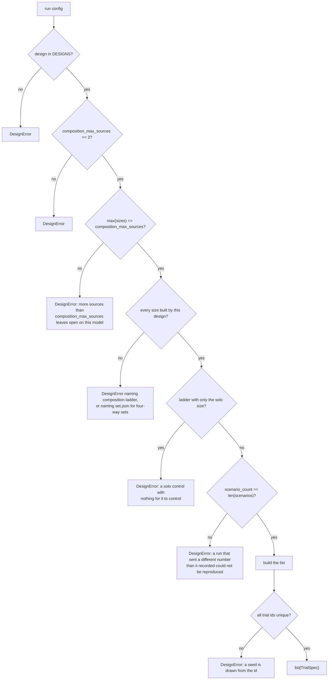

# 07 — `src/whowins/runner/design.py`: building a run's trial list

`design.py` turns the 1,080 base scenarios and a run config into the exact list of trials that the
run sends. **Nothing is random**: the list is a pure function of the config, so two people running
the same command send the same trials.

```bash
PYTHONPATH=src python3 -m whowins.runner.design ladder-qwen3-14b --balance
PYTHONPATH=src python3 -m whowins.runner.design ladder-qwen3-14b --show 3
```

---

## 1. Twelve designs, and why a new one gets a new *name*

```python
DESIGNS = ("pairwise-rotation", "pairwise-balanced", "composition-ladder",
           "composition-ladder-flat", "free-predictions", "load-cell", "load-bundles",
           "declared-tiers", "declared-tiers-6", "operator-decomposition", "one-message",
           "realism")
```

| Design | Sizes built | What it does |
|---|---|---|
| `pairwise-rotation` | 2 only | the first run's design. One two-source trial per scenario, with the sources **always** in the order S1 < S2 < … |
| `pairwise-balanced` | 1, 2 | the same conflicts in a balanced arrangement, with each side also asked alone |
| `composition-ladder` | 1, 2, 3, 5 | the same again at any declared size, with each source carrying a different option |
| `composition-ladder-flat` | 1, 2, 3, 5 | the same trials as `composition-ladder`, with the options dealt so that in every composition every source carries every option equally often, to within one trial. **The design for new runs** |
| `free-predictions` | 3, 4, 5 | the 80 sets of `data/splits/set.json` where several sources demand the same option (section 4b) |
| `load-cell` | 2 | the ten hand-written load trials, on each family's operator channel (section 4c). Frozen |
| `load-bundles` | 2 | the same ten and every hand-written bundle's ten in `data/load/`; the main run's (section 4c) |
| `declared-tiers` | 2 | two options of each scenario under declared tiers 1 to 12, twelve pairs a scenario, for capacity (section 4d). Frozen |
| `declared-tiers-6` | 2 | the same under tiers 1 to 6, six pairs a scenario, half the trials; the main run's ([17_layouts.md](17_layouts.md), section 6) |
| `operator-decomposition` | 2 | the operator's line first or last, as a real operator message or its label in a user message ([17_layouts.md](17_layouts.md)) |
| `one-message` | 2 | the user's line and the memory note in their own messages or inside the task's message |
| `realism` | 2 | the hand-written items of `data/realism/`, bare and in context |

`pairwise-rotation` is kept **exactly as it was**, so that `results/initial-qwen3-1.7b` can still
be rebuilt from its config. It should not be used again. It fixed the order of the sources, so
which source arrived last was decided by the source's **name**, and "which source wins" and "which
source is later" became the same column.

`pairwise-balanced` is also frozen as it was. It builds sizes 1 and 2 and rejects the rest, so the
two balanced runs on disk rebuild byte for byte. **The ladder got a new design name instead of
changing what an old name builds.** That is the standing rule in this repository: if a design
started building more under the same name, two runs carrying the same design string would mean
different things.

`composition-ladder` is frozen as well, so `results/ladder-qwen3-14b` still rebuilds from its
config. It dealt options unevenly (section 4), and the fix went into `composition-ladder-flat`.

`LADDER_SIZES = (1, 2, 3, 5)`, and 4 is left out on purpose. Four-way sets are enumerated in
`data/splits/set.json` under `not_in_declared_ladder`, and adding a rung is a scope decision that
someone has to make. The `DesignError` for a four-way request says so.

## 2. The five sources, and which channel each rides

```python
@dataclass(frozen=True)
class Source:
    source_id: str; transport_role: str; displayed_provenance: str
    def rides_on(self, operator_role):
        return operator_role if self.transport_role in ("system", "developer") \
               else self.transport_role
```

S1 declares `system` and S2 declares `developer`. The two are **one channel, told apart by their
label**. A role a model never saw in training would measure formatting instead of authority, and
the two chat families disagree about which role carries operator instructions (Qwen uses `system`,
gpt-oss uses `developer`). Every other source rides on the role it declares.

## 3. How a trial is laid out

```
 A composition is split into OPERATORS and OTHERS.

 operators (S1, S2)                    others (S3, S4, S5)         the task line
 ──────────────────                    ───────────────────         ─────────────
 always FIRST, and always in           freely permuted with        one of the free
 ONE message. Two of them become       the task line               region's slots
 a Block of two labelled lines.
      ▲
      └── the Qwen 3.5 template REJECTS a system message after the first, and Qwen 3's
          template would render one, so a trial built with two could not run on both ladders.
```

`arrangement_count(n_operators, n_others) = (2 if n_operators == 2 else 1) * (n_others + 1)!`

- the operator block can be written in either order when it holds two lines;
- the non-operator sources and the task line can come in any order;
- nothing else moves.

`arrangement_for(index, n_ops, n_others)` decodes an integer into `(operators reversed?, order of
the free region)`, enumerated in `itertools.permutations` order. That order is fixed, so an index
always rebuilds the same arrangement.

```
 composition          arrangements
 S1-S2                2   (2 operators, 0 others: only the block can swap)
 S1-S3                2   (1 operator, 1 other: [S3, task] or [task, S3])
 S3-S4                6   (0 operators, 2 others: 3! orders)
 S1-S2-S3             4
 S3-S4-S5            24
 S1-S2-S3-S4-S5      48
```

`_units()` builds the elements in the order they are sent and hands out slots **after** the
arrangement is settled, because `TrialSpec` rejects spans whose recorded slots disagree with the
element order. A source riding on `tool` gets an assistant turn calling `config_read` immediately
before it, because both engines reject a tool result that answers no call.

## 4. How options are dealt to sources

```python
assignments(scenarios, pairs)            # pairwise-rotation / -balanced
ladder_assignments(scenarios, comps, …)  # composition-ladder, any size
flat_assignments(scenarios, comps, …)    # composition-ladder-flat, any size
```

Both ladders share `_cells`, which gives each scenario its composition and arrangement. Within each
family, scenario `j` takes:

```
 within, block  = j % len(compositions), j // len(compositions)
 composition    = compositions[within]                  ← every composition gets an equal share
 option set     = option_sets(scenario, size)[(j + block) % n_sets]
 permutation    = block % size          (rotation: `flipped = bool(block % 2)`)
 arrangement    = (count of trials already built for THIS composition) % arrangements
```

`permutation_for(index, size)` is a **cyclic** Latin square: source *i* takes option
`(i + index) % size`, so over `size` consecutive values every source carries every option once. At
`n = 2` this is the same as `flipped`. Using all `n!` permutations instead was tried, and it spread
the data so thinly that the arrangement counter did not reach every arrangement.

In `composition-ladder` the option-set index and the permutation cycle with different periods
(`(j + block) % n_sets` against `block % size`), and within one composition `block` only gets to
about 23, so the two cycles do not complete together. The table of which source carries which
option id is flat for the five-way set and uneven at sizes 2 and 3: in S3-S4-S5, S5 carried `o4` 8
times where S3 and S4 carried it 24. Option ids are not equally easy (alone, the 14B produced `o1`
0.85 of the time and `o3` 0.77), so a source could look weak for the options it was handed. The
same dealing also tied options to positions: in S1-S2, `o1` was always the first line and `o5`
always the second, and in the triples an option sat last up to 38 points more than its share
(finding G of the code audit).

`composition-ladder-flat` keeps the compositions, the arrangements and the trial ids, and deals the
options differently, per composition and per option count `n` (5, or 2 for refusal):

```
 turn         = how many trials of this composition with n options came before
 source i     carries option (offset_i + rotation) mod n
 rotation     = (turn + turn // lcm(n, arrangements)) mod n
 offsets      = one of the ordered choices (0, a, b, …) of distinct options, changed after
                n × arrangements trials, or every n trials where two such cycles do not fit
```

The rotation steps every trial, so over any `n` trials each source carries each option once: the
gap between sources is at most one trial. The extra step every `lcm(n, arrangements)` trials makes
each arrangement meet each rotation, so no option is tied to a position. Holding the offsets for a
whole cycle keeps that exact. The fallback to every `n` trials matters only for S3-S4-S5, whose 96
trials cannot hold two cycles of 120; it keeps all ten option sets in use there.

| | `composition-ladder` | `composition-ladder-flat` |
|---|---|---|
| a source's share of an option, worst gap between sources | 16 trials (16.7%) | 1 trial (1%) |
| an option sitting last, worst distance from its fair share | 50 points (pairs), 38 (triples) | 1–3 points, 5 in S3-S4-S5 |
| slot balance, arrangements used, option sets used | exact, all, all | exact, all, all |

Two details were bugs once:

- **The arrangement counter runs per composition, across the families.** A single family holds
  only 24 scenarios per composition, which is not enough to reach every arrangement of a triple.
- **The arrangement is NOT nested under the permutation.** Nesting it meant the free triple reached
  only 8 of its 24 arrangements and put one source first twice as often as another: S3 led 36 of
  96 trials against S5's 18. Removing the nesting was the whole of the position fix.

## 4b. Free predictions

`free_trials` sends each scenario once per size (3, 4 and 5 sources), a grouping from
`free_groupings()` in turn, so 3,240 trials. A grouping such as `[["S1"], ["S2", "S3"]]` has two
groups, each demanding one option, so every scenario qualifies, refusal included. The groups are
dealt options by `_flat_cells`, the flat ladder's rule with groups in place of sources: every
group carries every option to within two trials. The trial id joins the sources that share an
option with `+`, as in `fmt-0001@S1|S2+S3`, so it never matches a ladder trial's id. There is no
solo arm, because the ladder run of the same model has one. Arrangements are counted per grouping
but a grouping's trial count is not a multiple of its arrangements, so slot balance is close rather
than exact; the prediction is made per trial, arrangement included, so this does not bias it.
`build_composition_trial(…, groups=…)` checks that the groups partition the sources and that each
group carries one option and each a different one.

## 4c. The load cell

`load_cell_trials` rebuilds the ten worked trials of `data/trials/03-load.json` with
`trials.reconstruct` and moves their one operator block, spans included, onto the family's operator
role: `system` on Qwen, `developer` on gpt-oss, which would not receive the worked trials' `system`
message. Each trial is composite: its conflict groups are scored one by one, the fillers are
checked, and `all_satisfied` is the conjunction. Ten trials from one bundle of six scenarios is
little data, so `load-bundles` adds every hand-written bundle in `data/load/`, refusing to build if
any fails the bundle validator. `load-cell` stays frozen at the worked ten.
[16_load_bundles_and_tiers.md](16_load_bundles_and_tiers.md) describes the bundles.

## 4d. Declared tiers

`tier_trials` gives each scenario twelve of the 66 pairs of tiers 1 to 12, scenario i taking pairs
12i to 12i + 11 round the list, so each pair gets 196 or 197 items: 12,960 trials. Two options of
the scenario carry the two tiers, the lower tier winning under the stated policy. Within a pair,
which option wins and whether it comes first cycle through all four combinations. The policy rides
on the family's operator role through `TrialSpec.policy_role`, and each record carries the ranks
and the option the policy makes win, which `whowins.stats.capacity` reads.
[16_load_bundles_and_tiers.md](16_load_bundles_and_tiers.md) says why the setup is fixed.

## 5. The solo arm

```python
build_balanced_trial(..., solo="S3")
build_composition_trial(..., solo="S3")
```

`solo` keeps one source and **deletes the other sources' turns without changing anything else**:
the same scenario, the same option, the same arrangement, the same place in the conversation. That
makes it a control and not a second experiment. The free-region order is re-indexed so that the
remaining sources and the task keep their relative positions.

Without the solo arm, *"an option the model simply cannot produce"* looks the same as *"an option
it declined to take"*, and the first run could not tell those apart for the 154 format trials
nothing could label.

Solo trials are emitted **before** their conflict. A run cut short therefore has the control for
every conflict it reached, instead of conflicts with no control.

The ids keep the arms apart. `path-0008@S1-S3` is the conflict, `path-0008@S1` is its solo in the
balanced design, and `path-0008@S1-S3-S5~S1` is its solo in the ladder. In the ladder a scenario
appears in a pair, a triple and the five-way set, so `scenario@S1` would name three different
trials, and a run resumes by trial id.

The ladder config `ladder-qwen3-14b` has no solo arm (`composition_sizes` is `[2, 3, 5]`). Its
config explains why: `balanced-qwen3-14b` already measured solo ability for the pairs on this
model, and a size-1 arm would add ten solo trials per scenario.

## 6. `trials_for_run(run, scenarios)`: the checks before building



`eligible_for(scenarios, size)` drops any scenario with fewer than `size` options. It reads the
scenario's own option count and **never the family name**, so a family that gained options would
join without an edit here. Refusal is binary, so sizes 3 and 5 carry 960 scenarios, and the command
logs which family was left out and why.

## 7. What one run sends

```
 balanced-qwen3-1.7b / -14b   1,080 conflicts + 2,160 solos = 3,240 trials × 3 draws = 9,720
 ladder-qwen3-14b             1,080 pairs + 960 triples + 960 five-way = 3,000 × 3 = 9,000
```

## 8. `--balance`: read it before a run

```
 composition-ladder
  composition            n  arrangements  slot spread  option spread  option last
  S1-S2                108      2/2               0%           20%        +50%
  S3-S4                108      6/6               0%           15%        +25%
  S3-S4-S5              96     24/24              0%           67%        +24%
  S1-S2-S3-S4-S5       960     48/48              0%            0%         +0%
 composition-ladder-flat
  S1-S2                108      2/2               0%            5%         +2%
  S3-S4                108      6/6               0%            5%         +3%
  S3-S4-S5              96     24/24              0%            5%         +5%
  S1-S2-S3-S4-S5       960     48/48              0%            0%         +0%
```

- **arrangements**: how many of a composition's arrangements are used. It should be all of them.
- **slot spread**: how unevenly each source sits in each slot. **A non-zero value means a source's
  strength is confounded with its position**, which is what the first run's precedence table turned
  out to measure. It is 0% everywhere today, and `<-- position` is printed next to any composition
  where it is not.
- **option spread**: for each option id, how unevenly the sources carry it, as (most − fewest) /
  most. Around 5% is one trial in twenty, the floor when a composition's trials are not a
  multiple of five.
- **option last**: the worst distance, over option ids, from sitting last `1/size` of the time. The
  later instruction wins about nine times in ten, so an option that sits last more often gains wins
  it did not earn. `tests/test_batch.py` bounds both for the flat ladder (section 4 and finding G).

The tier and load designs set no sources against each other, so the report once crashed on them.
It now prints their own balance: for a tier run, each tier pair's items, the most any two of the
four winner cases differ (1), and how many pairs of options meet (all ten); for a load run, the
trials per bundle and per `(n, k)`.

## 9. `print_balance` and the analysis are different checks

`--balance` reads the *design*, and `whowins.runner.analyse` reads the *records*. They answer the same
question from opposite ends, so a run that changed while it was being sent would show up as a
disagreement between them.
