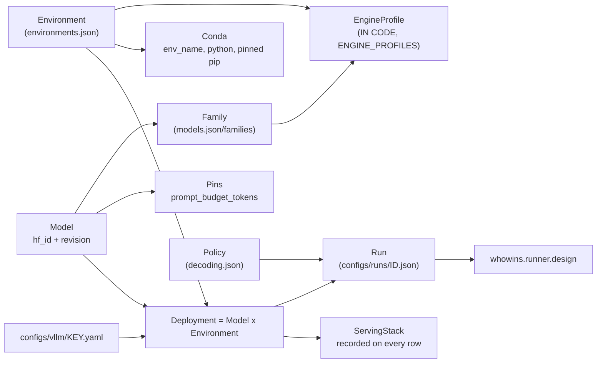

# 08 — `configs/` and `src/whowins/runner/serving.py`: models, machines, policies, runs

`serving.py` is the one module that reads every config file, and it stops when any two of them
disagree. **A machine is part of the experiment**: there are two machines, two engine versions and
two number formats, and a record from one machine is not a record from the other.

```bash
PYTHONPATH=src python3 -m whowins.runner.serving check
# 15 models in 2 environments (16 deployments), 10 decoding policies and 214 run(s) agree
```

```
configs/
├── environments.json         the two machines
├── models.json               the fifteen models + the three families + the study pins
├── vllm/<key>.yaml           exact `vllm serve` settings, one per deployment
├── decoding.json             nine named sampling policies
├── runs/<run_id>.json        every run: four test runs, the main run, the 32B's -sm80 copies
└── chat-templates/*.jinja    copies of the three Qwen templates, for the tests
```

---

## 1. The object graph



## 2. `ENGINE_PROFILES`: claims about an engine are kept in code

```python
ENGINE_PROFILES = {
  "vllm-0.28": EngineProfile(requires=_COMMON_REQUIRES, forbids=_COMMON_FORBIDS,
      family_flags={"qwen3.5": {"enable-auto-tool-choice": True,
                                "tool-call-parser": "qwen3_coder",
                                "reasoning-parser": "qwen3",
                                "default-chat-template-kwargs": {"enable_thinking": False}},
                    "gpt-oss": {"enable-auto-tool-choice": True,
                                "tool-call-parser": "openai"},
                    "qwen3":   {"enable-auto-tool-choice": True,
                                "tool-call-parser": "hermes",
                                "reasoning-parser": "qwen3",
                                "default-chat-template-kwargs": {"enable_thinking": False}}}),
  "vllm-0.8":  EngineProfile(requires=_COMMON_REQUIRES + {"no-enable-chunked-prefill": True},
      forbids=_COMMON_FORBIDS + ("reasoning-parser",
                                "enable-reasoning", "default-chat-template-kwargs"),
      family_flags={"qwen3": {"enable-auto-tool-choice": True,
                              "tool-call-parser": "hermes"}}),
}
```

Profiles are keyed by **engine version**, not by environment, so two machines on vLLM 0.28.0 obey
the same rules. They are in code instead of a config file **because every line was read out of
that version's source**, and a JSON file would let someone declare a behaviour that nobody checked.

```
 _COMMON_REQUIRES                      _COMMON_FORBIDS
 ────────────────                      ───────────────
 generation-config: "vllm"             enable-prefix-caching   trust-remote-code
   no sampling default from the        speculative-config      chat-template
   checkpoint                          trust-request-chat-template
 no-enable-prefix-caching: true        language-model-only     hf-overrides
   the `no-` form fails with an        override-generation-config
   error if the flag ever goes         quantization
   away; `enable-prefix-caching:
   false` would be dropped without     each changes the prompt, the numerics, or the draw
   a message
 seed: 0
```

`_check_serve` then rejects a serve file that disagrees with anything: the wrong model or
revision, a missing or wrong required flag, a forbidden flag, or **any flag the study does not
account for**. Required flags are compared with `type()` as well as `==`, because in Python
`0 == False` and `seed: false` would otherwise pass. The error message for an unknown flag says
that "a flag that changes nothing measured still has to be added here on purpose".

## 3. The two machines

| | `v100-vllm085` | `sm80-vllm0280` |
|---|---|---|
| Hardware | DGX-1, 8 × V100-SXM2 32 GB (compute 7.0) | 80 GB cards, compute ≥ 8.0 |
| Engine | vLLM 0.8.5.post1, V0 engine, XFormers | vLLM 0.28.0, V1 engine |
| Number format | **float16** | bfloat16 |
| Conda | `ipb-v100`: py 3.10.18, torch 2.6.0, transformers 4.57.1 | `ipb-sm80`: py 3.12, openai-harmony 0.0.8 |
| Reasoning split by | **the client** (`whowins.runner.response`) | **the server** (vLLM's `qwen3` parser) |
| Ladder served | Qwen 3, 0.6B–32B | Qwen 3.5 0.8B–122B-A10B, gpt-oss 20B/120B; and a copy of each of the Qwen 3 32B's main runs (section 10) |
| Exclusive GPUs | no, the machine is shared | yes |

Each `why` in `environments.json` cites the source line it was read from. The V100 serves float16
because vLLM 0.8.5 rejects bfloat16 below compute capability 8.0. It sets `VLLM_USE_V1=0`
explicitly instead of relying on the fallback. It starts **no reasoning parser**, because the only
one that version has (`deepseek_r1`) files the whole answer as reasoning whenever a reply has no
`</think>`, and with thinking off that is every reply.

Because the V100 splits reasoning in the client, anything that sends a model's reply back to it has
to split it first. `batch._answer_calls` does, when thinking is on (finding F of
the code audit).

`_conda()` cross-checks the pins. Every pip line must name a version, the engine pin must equal
the environment's `engine_version`, the harmony pin must equal `openai_harmony_version`, and
anything the machine reports as installed must agree with what it installs (`2.6.0+cu124` matches
a pin of `2.6.0`).

## 4. The roster

There are fifteen models, each pinned to a full 40-hex commit, in three families:

| Family | prompt renderer | operator role | operator first only? | rejected role | thinking control |
|---|---|---|---|---|---|
| `qwen3` | `hf-jinja` (template inside `tokenizer_config.json`) | `system` | yes, by our rule; waivable | `developer`: Qwen 3's template renders four roles and **drops** it without an error | `enable_thinking` |
| `qwen3.5` | `hf-jinja` (`chat_template.jinja`) | `system` | yes, by the template | `developer`: vLLM 0.28.0 **renames** it to system and merges it into the first system message | `enable_thinking` |
| `gpt-oss` | `openai-harmony` | `developer` | no | `system`: vLLM gives gpt-oss every system instruction as a harmony **developer** message | `reasoning_effort` |

`REFUSED_ROLE_REASONS` and `OPERATOR_FIRST_REASONS` hold one sentence per fact about an engine and
a template. A family names a *code*, and the code maps to the *sentence*, because the sentence is a
claim about source code that someone read.

`thinking_prefills_open_block` records whether asking a family to think leaves a `<think>` block
open at the end of the prompt. Qwen 3.5's template does; Qwen 3's prefills nothing, and the model
writes its own opening tag. Wherever this package splits the thinking itself, the flag decides how
a reply with no tag at all is read. `rescore` and `analyse` both pass it to the parser.

`load_roster` also checks that the **vendored chat template** in `configs/chat-templates/` hashes
to the `checkpoint_chat_template_sha256` the roster pins, that every model is served somewhere,
that no model is deployed on an engine its family was never checked against, and that no two models
share a serve file.

## 5. Decoding policies

`decoding.json` holds nine named policies. `load_policies` rejects a policy with a missing or
unknown key, because a misspelt `top_k` would otherwise be dropped and its value left to the server.

| Policy | Role | Used for |
|---|---|---|
| `study-nothink` | study | **every Qwen model of both generations**, thinking off |
| `study-think` | study | every Qwen model, thinking on |
| `card-qwen3.5-*` (4) | card-check | rerun a slice of trials under that model card's own numbers, to measure what departing from the card costs |
| `study-think-gpt-oss` | study | gpt-oss, which has no non-thinking mode: `study-think`'s sampling at high effort, so the thinking arm is sampled one way |
| `gpt-oss-low` / `-medium` / `-high` | effort-condition | the gpt-oss README's sampling at each effort; reasoning effort is a **setting**, not a separate model |

There is **one setting per thinking mode**, so that a difference between two rungs, or between the
two ladders, is not also a difference in how they were sampled. The model cards disagree with each
other: Qwen 3.5 0.8B and 2B ask for temperature 1.0, while every other card asks for 0.7 or 0.6.
Following each card would put a settings change at exactly the place where a size effect is
measured.

`presence_penalty` is 0 in every study policy. It lowers the probability of every token already
written, so it works against answers that repeat tokens (list markers, JSON quotes, tool-call tags)
and would favour some options over others for a reason the instructions do not give. For Qwen 3.5
that departs from the card's 1.5/2.0, and the `card-*` policies exist to measure what it costs.

## 6. A run config

```json
{
  "run_id": "ladder-qwen3-14b",
  "status": "exploratory",  "confirmatory": false,
  "model": "qwen3-14b",     "environment": "v100-vllm085",
  "decoding": "study-nothink",
  "base_seed": 20260916,    "repeats": 3,
  "scenarios": "all",       "scenario_count": 1080,
  "composition_max_sources": 5,
  "composition_sizes": [2, 3, 5],
  "tool_turns": 6,
  "design": "composition-ladder"
}
```

The real file also carries an `_about` list of sentences explaining the choices.

| Field | Meaning |
|---|---|
| `design` | how the trials are laid out; a new layout gets a new **name** |
| `composition_sizes` | which arms to send: `1` is the solo control, `2` the conflict, 3 and 5 the ladder |
| `composition_max_sources` | a per-model ceiling that keeps the sets above a pair closed on a model that is also a rung of the scale ladder. Only the ladders and `free-predictions` build sizes above 2 |
| `tool_turns` | how many times the loop answers a tool call and asks again (1–12) |
| `repeats` | draws per trial. With one draw at temperature 0.7, the draw cannot be told apart from the item itself; the tier runs take one anyway, because capacity keeps one draw per item |
| `base_seed` | different on every run, so that a draw is a new draw and not the same one sent twice. The one exception is a copy of a run on the other machine (the 32B's `-sm80` runs), which keeps its twin's seed so either copy can stand in |
| `scenario_count` | a run that sent a different number of scenarios than it recorded could not be reproduced |

`request_seed(base_seed, trial_id, repeat)` is the low 31 bits of
`sha256("seed\x1ftrial\x1frepeat")`. The attempt number is left out of the hash on purpose, so a
retry after a transport fault asks for the same draw again.

The four test-run configs:

| run_id | model | design | sizes | repeats | draws | records |
|---|---|---|---|---|---|---|
| `initial-qwen3-1.7b` | 1.7B | pairwise-rotation | 2 | 1 | 1,080 | not in this repository |
| `balanced-qwen3-1.7b` | 1.7B | pairwise-balanced | 1, 2 | 3 | 9,720 | not in this repository |
| `balanced-qwen3-14b` | 14B | pairwise-balanced | 1, 2 | 3 | 9,720 | not in this repository |
| `ladder-qwen3-14b` | 14B | composition-ladder | 2, 3, 5 | 3 | 9,000 | not in this repository |

And 210 main-run configs. 196 are `configs/runs/main-<kind>-<model>-<mode>.json`: seven kinds for
each of the 13 Qwen models with thinking off and on and the two gpt-oss models with thinking on.
Within a kind they differ only in model, mode and seed; a test pins that. The other fourteen are the
32B's copies on the 80 GB cards, `main-<kind>-qwen3-32b-<mode>-sm80` (section 10). The four kinds
below were the first; [runbook.md](../../runbook.md), section 7a, has all seven.

| kind | design | sizes | repeats | trials a run |
|---|---|---|---|---|
| `ladder` | `composition-ladder-flat` | 1, 2, 3, 5 | 3 | 12,840 |
| `free` | `free-predictions` | 3, 4, 5 | 3 | 3,240 |
| `load` | `load-bundles` | 2 | 3 | 10 per bundle |
| `tier` | `declared-tiers` | 2 | 1 | 12,960 |

Every one says `"confirmatory": false`, for good: there is no pre-registration (2026-09-29).

## 7. The two guards every request passes

```python
build_model_request(spec, scenarios, deployment, decoding)
  ├── check_policy(deployment, decoding)
  └── check_delivery(render_dicts(spec, scenarios), family)
```

**`check_policy` rejects a decoding that:**

- leaves any of the nine sampling fields to the server (every draw has to state every setting);
- uses the other family's reasoning control (`reasoning_effort` on Qwen, `enable_thinking` on
  gpt-oss), because a record carrying it would claim a setting that did nothing;
- omits Qwen's thinking switch entirely. Every template in the family has a default, the defaults
  disagree, and vLLM's `qwen3` parser **assumes thinking when a request does not say**, which files
  the whole answer as reasoning;
- lets `max_tokens` eat into the prompt budget, i.e. fails
  `max_tokens ≤ max-model-len − prompt_budget_tokens`. vLLM would not reject a longer prompt; it
  would **shorten the answer's budget to fit**, so where an answer was cut off would depend on how
  long its prompt was. Today the values are 32,768 ≤ 40,960 − 8,192, exactly at the limit.

**`check_delivery` rejects messages that would not reach this family as written:**

1. every role must be one the family carries **as itself**;
2. content must be text;
3. operator instructions must be one message, placed first, where the family requires it. On
   Qwen 3 that is the study's own rule (`one-operator-message-per-trial`), and a trial built to
   send the operator late (`meta["operator_late"]`) waives it through `late_operator=True`; Qwen
   3.5's template refusal is never waived ([17_layouts.md](17_layouts.md), section 1);
4. every tool result must answer an earlier assistant call **by id**, because otherwise gpt-oss
   would receive it from a function with an empty name;
5. there must be a user message, because the task is one.

A rejection raises `UndeliverableTrial`, which is a `ValueError`. `batch --dry-run` builds and
checks every request before anything is sent. During a real run `one_draw` catches it, sends
nothing more for that trial, and the run loop writes a `failure` line naming the turn and the
reason, so one bad trial does not end the run (finding M of the code audit).

## 8. Free GPUs on a shared machine

`choose_gpus(rows, need, want=…)` picks the lowest-numbered free cards, or checks the ones you
named. A card counts as free when **under 512 MiB** is in use: an idle card on the DGX-1 reports
6 MiB, and the smallest busy one seen reported 1,644 MiB. vLLM takes a fraction of each card's
**total** memory, not of what is free, so starting beside another job either fails at startup or
starves that job.

## 9. `preflight.py`: checking a live server

It only reads: `/version`, `/v1/models`, and the chat template in this machine's Hugging Face
cache.

| Check | Fails when |
|---|---|
| engine version | the server's `/version` is not the environment's pin |
| served model | `/v1/models` does not list **exactly** the pinned `hf_id` |
| context length | the server's `max_model_len` is not the serve file's |
| chat template | the cached template's sha256 is not the roster's, read from `chat_template.jinja` or from `tokenizer_config.json["chat_template"]`, whichever the family declares |
| openai-harmony | gpt-oss only: the installed version is not the environment's pin |

`exit_status` returns `0` when everything passed, `1` when something failed, and **`3` when
nothing failed but something could not be checked**. A script must never read `3` as a pass.
`whowins.runner.batch` runs the checks before sending anything and aborts on `1`. On `3` it logs each
unchecked item as a warning and carries on.

After preflight, `batch` asks `/version` again (`server_version`) and passes the answer to
`serving.stack_for`, which builds the `ServingStack` recorded on every row. `stack_for` rejects a
reported version that differs from the environment's pin unless `allow_unpinned` is set.
`server_version` returns `None` on any error. `batch` then passes `"unreported"`, which differs
from every pin, so the run stops with a config error unless `--allow-unpinned-engine` is given, and
then every row records `vllm_version: "unreported"`. Before, `stack_for` recorded the pinned version
as if the server had reported it. Preflight fails first on an unreadable `/version`, so this only
arises with `--skip-preflight` (finding N of the code audit).
`stack_for` called without a version, as the tests do, still assumes the pin.

## 10. One model in two places: the Qwen 3 32B

Since 2026-10-10 `qwen3-32b` has two deployments: `v100-vllm085` with `vllm/qwen3-32b.yaml`, and
`sm80-vllm0280` with `vllm/qwen3-32b-sm80.yaml`. The second runs a copy of each of its fourteen
main runs. Since 2026-10-11 those copies are the ones to use for the 32B, and the DGX-1's two
ladders are kept only to show how much the serving software moves a result.

| | `qwen3-32b.yaml` | `qwen3-32b-sm80.yaml` |
|---|---|---|
| dtype | float16 | bfloat16 |
| tensor-parallel-size | 4 (32 GB V100s) | 2 (80 GB cards; about 65 GB of weights) |
| chunked prefill | `no-enable-chunked-prefill: true` | always on in the V1 engine |
| tool parser | `hermes` | `hermes` |
| reasoning parser | none: the client splits | `qwen3`: the server splits |
| `default-chat-template-kwargs` | does not exist in 0.8.5 | `{"enable_thinking": false}`, a safety net |

Everything else in the two files is the same. For Qwen 3 to be served on vLLM 0.28.0 at all, the
family lists both engine profiles, and `ENGINE_PROFILES["vllm-0.28"]` holds Qwen 3's flags, read
out of that version's source. What reaches the model is the same on both: vLLM 0.28.0 renames a
`developer` message and merges it into the first system message, but only when a request holds
one, and the guard refuses one on Qwen 3 anyway. A later `system` message reaches Qwen 3's template
unchanged on both engines, so the operator test's late-operator trials are sent as recorded.

**Which deployment a command gets.** `Model.deployment` is the first one listed, and
`serving shell`, `serving gpus`, `serve.sh` and `preflight.sh` use it when no environment is
named. The DGX-1 is listed first, so its scripts, which name none, still serve the 32B there. On
the 80 GB cards every command names the environment: `scripts/serve.sh --env sm80-vllm0280
qwen3-32b` and `scripts/preflight.sh qwen3-32b --environment sm80-vllm0280`. A run config names
its environment itself, so `run_trials.sh` needs nothing more.

**The copies.** `main-<kind>-qwen3-32b-<mode>-sm80` matches its twin
`main-<kind>-qwen3-32b-<mode>` in every field but `environment`, `run_id` and `_about`, the seed
included, so both build the same trials and ask for the same seed on every draw. A test in
`test_serving.py` reads each pair, and the two serve files, and fails on any other difference.

**What the copies mix in.** A copy's records come from a different engine, number format and GPU
from the rest of Qwen 3, and its thinking is split by the server, not the client. A Qwen 3 reply
that thinks without writing any tag would be read differently by the two: as the answer on the
DGX-1, as reasoning on the 80 GB cards. It has not happened in 70,504 DGX-1 thinking turns read.
Any Qwen 3 size trend that uses a `-sm80` run mixes size with the serving stack at its largest
rung, and has to say so.
