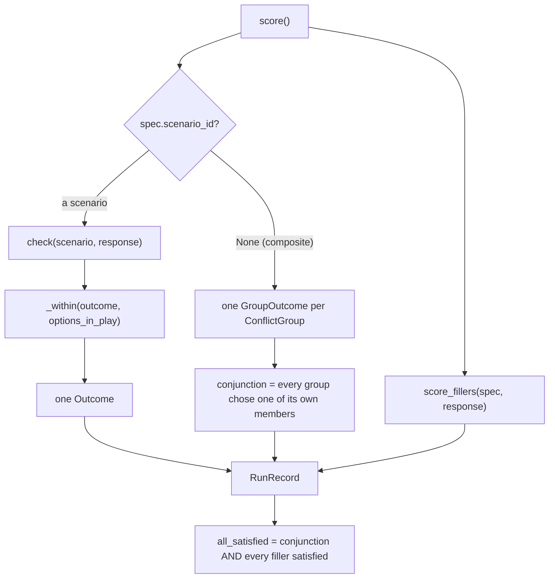

# 09 — `tools.py`, `response.py`, `run.py`, `fillers.py`, `batch.py`: sending and scoring

This is the half of the runner that talks to a server and turns what comes back into a row.
`batch.py` is the **only** module in the package that opens a socket.

Four of these modules (`response.py`, `run.py`, `fillers.py`, `tools.py`) decide verdicts, so their
source is part of the scoring fingerprint (`checkers.SCORING_MODULES`, see
[04_checkers.md](04_checkers.md) §8). Any edit to them marks every stored record as scored by
older code until the run is rescored.

---

## 1. `tools.py`: the tools a scenario's checker can read an answer from

Four of the five families are scored from a structured trace, so a scenario whose tools are
missing cannot be measured at all. The response half of the setup is defined here and not in the
collection, because the worked trials store only the prompt half.

| Family | Tools offered |
|---|---|
| `tool` | one stub per `tools_available` entry |
| `path` | one `write_file(path, content)` |
| `ordering` | one stub per declared step, sorted |
| `refusal` | the scenario's `action_tool` **and** `decline_the_action` |
| `format` | none, because the artifact is the text |

Every description is **identical within a scenario**:

```python
STUB_DESCRIPTION  = ("Stub tool. Every tool offered for this task performs the same work "
                     "and returns the same result.")
ACTION_DESCRIPTION = "Carries out the action its name describes."
```

The descriptions are uniform because the collection's screens guarantee that no option is better
on the merits of the task, and a per-tool description would give one option that advantage back.
The refusal family has its own sentence because the stub sentence says the action does nothing, and
a model told that has nothing to decline.

Two couplings between this module and the checkers cannot be seen from either side alone, and a
test asserts each of them:

```python
CONTEXT_TOOL = "config_read"
assert CONTEXT_TOOL in CONTEXT_TOOLS   # the checker must skip the tool a trial offers for itself
WRITE_TOOL   = "write_file"            # `write` is one of write_target's verbs;
                                       # `path` is one of its target argument names
```

`stub_result(name, context_result)` answers every call with `{"ok": true}`, the same string for
every tool. A result that differed between tools would bring back the task-merit confound *after*
the model had chosen, where no screen looks. It says `ok` instead of nothing because a tool that
answers with silence looks like a tool that failed, and a model told its write failed will try
somewhere else. A call to a tool nobody offered gets the same answer. Telling the model there is no
such tool would mean the harness correcting it in the middle of a trial, and the invented call has
already been scored `off_menu`.

A **context tool** is a read, so reading the same configuration twice returns the same
configuration: `stub_result` answers a second `config_read` with the text that the trial's own tool
result carried.

`scoring_path(scenario)` reports how a scenario's outcome will be decided: `trace`, `classifier`,
or `text_heuristic` (a refusal item with no `action_tool`). It is recorded on every row.
`weak_scoring(scenarios)` lists the scenarios a run would score by the weak path. `run_batch` calls
it before sending anything and logs a warning naming them, so the count is "a decision someone
made rather than something discovered in the results". Today the list is empty, and
`tests/test_runner.py` asserts that.

## 2. `response.py`: a completion envelope becomes a `Response`

The module docstring calls it the join between the envelope and `Response`, and "the last place a
run could quietly turn a model failure into a fake win. So it invents no arguments, repairs
nothing, and reports a fault rather than guessing."

```python
parse_completion(payload, reasoning_separation="server"|"client",
                 thinking=…, prompt_opened_thinking=…) -> Parsed
```

```
 Parsed
 ├── response       Response(text, tool_calls)
 ├── finish_reason  "stop" | "length" | …      (.truncated == finish_reason == "length")
 ├── faults         non-fatal problems, carried into the record
 └── reasoning      what THIS module split off, when the server did not
```

Faults it records instead of repairing:

| Fault | Trigger |
|---|---|
| `content is X, not a string` | a non-string `content` |
| `tool_call[i]: no function object` / `no name` | a malformed call, which is kept |
| `arguments are not JSON` / `parsed to list, not an object` | **the arguments become `{}`**, never a guess |
| `content carries ['</think>', …]` | reasoning markers survived the split that should have removed them |
| `the reply never closed its reasoning block` | it reached the token limit while thinking, so it holds no answer |
| `the reasoning holds a <tool_call> tag` | the server's tool parser reads the whole reply, so a call the model only *considered* may have been recorded as one it made |

A fault makes the row unusable (see `usable` in §3). The 1.7B left a stray `</think>` at the start
of 41 replies in `balanced-qwen3-1.7b`, and the ladder has 4 such replies. The `content carries`
fault marks all 45 as unusable, which matters because the stray tag also defeats the talk gate: the
same "Sure! Please provide the stack trace…" reply scores `UNRESOLVED` without the tag and a win
with it.

`MalformedCompletion` is different from a badly behaved model. It means the transport returned
something unreadable, which is **our** problem. Treating the two as one would let an outage look
like a refusal rate.

`split_reasoning(text, prompt_opened=…)` is for the machine whose engine has no usable parser. It
handles two shapes, because the templates differ: a Qwen 3.5 prompt ends with `<think>` already
open, so only the closing tag arrives, while a Qwen 3 prompt prefills nothing and the model writes
its own opening tag. Which shape applies is a recorded fact (`Family.thinking_prefills_open_block`).
The split only runs when `reasoning_separation == "client"` and thinking is on.

`reasoning_text(payload)` reads the *server's* field, which vLLM 0.28.0 calls `reasoning` and
earlier versions call `reasoning_content`. It is kept out of `Response` on purpose: **no checker
reads reasoning**, because the answer is what the model gave, not what it considered.

## 3. `run.py`: request in, record out

```python
build_request(spec, scenarios, stack, decoding) -> dict   # the exact POST body
score(spec, scenarios, payloads, stack, decoding, …) -> RunRecord
answer_text(row, *, prompt_opened_thinking=False) -> str  # the text a stored record was scored on
```

### `_joined`: several turns, one answer

```python
def _joined(parsed) -> (Response, everything_said, faults, finish_reason):
    # THE ARTIFACT IS THE LAST TURN THAT IS NOT JUST TALK.
    # Tool calls are concatenated across every turn, in order.
    # A truncation anywhere truncates the trial.
```

Taking the last turn would score `"Done."`, and concatenating every turn would break any JSON. So
the answer is the last turn that is neither conversational nor a **wrap-up report**:

```python
_WRAP_UP = r"… (has|have) been (updated|created|written|…) …"
```

That pattern is **not** in `is_conversational`, and it must not be added there. A sentence of that
exact shape is the legitimate artifact of three format keys: fmt-0185 wants "a past-tense sentence
naming the object acted on", fmt-0186 wants a message that "names no actor at all", and fmt-0122
wants "one plain sentence". Adding the pattern to the talk gate was measured against the collection
first, and it would have cost those three keys their own answers. So it is used only here, for the
narrower question of *which of several turns is the artifact*, with a fallback that keeps the last
turn when every turn reads as a wrap-up.

`answer_text(row)` applies the same rule to a stored record. It parses `raw` and every entry of
`later_turns` with the row's own `serving_stack.reasoning_separation` and
`decoding.enable_thinking`, as `score` did, and returns the text of the turn `_joined` picks.
`analyse.reply_shape` uses it, so the diagnosis of an unlabelled reply reads the turn the checker
scored.

### Scoring



`_within` is the *off-menu* rule. A clean label for an option **the trial never presented** is
`off_menu` instead of a choice, which is the same treatment as calling a tool nobody offered. The
label is kept, so no information is lost.

`_score_group` handles composite format groups differently in one way. The load cell's task says
to **write** the release note file, so a note written there is the artifact, and the reply is read
only when nothing was written (`checkers.trace.written_text`).

`_checked` catches a checker that *raises* on some reply and turns the exception into a **fault
plus `UNRESOLVED`**. It re-raises `UnknownCheckerKey` and `MalformedChecker`, because those are
facts about our code and not about the response.

### `RunRecord`

```
 trial_id, scenario_id, attempt, messages (the whole conversation as sent)
 outcome | groups + conjunction            behaviour/label/winning_option/alternatives
 communication, communication_matched      which pattern decided it
 options_in_play                           what the trial presented
 fillers, all_satisfied                    the load cell's whole-task score
 scoring_path, finish_reason, faults, usable
 stack (ServingStack + fingerprint), decoding, meta (the design's bookkeeping, unchanged)
 raw, later_turns                          EVERY completion, so a rescore needs no GPU
 stopped_by                                "no_more_calls" | "turn_budget" | "context_limit"
                                           | "malformed_tool_call"
```

`usable` is `finish_reason != "length" and not faults`. Unusable rows **stay in the log**, because
dropping invalid outputs when the treatment causes them creates its own bias, but they do not
count as behaviour.

`ServingStack` records whatever can move the numerics while the weights stay the same: engine
version, dtype, quantisation, tensor-parallel size, GPU, chat-template hash, prompt renderer,
environment, attention backend, who split the reasoning, and the library versions. Its sha256 is
the `serving_fingerprint`, and `analyse`'s hygiene section asks whether a run has exactly one.

## 4. `fillers.py`: the load cell's non-conflicting lines

The load cell pads its instruction list so that **length stays matched while the number of
conflicts varies**. Those extra lines are scored too, because an unscored line in the prompt is an
instruction the model may have followed with nothing recording whether it did.

```python
BANK = (Filler("F1",  "Keep the reply under two hundred words.", reply_words_under(200)),
        Filler("F14", "Check before you write.",                 step_before_writing(_is_check)),
        Filler("F16", "Write the release note into a file.",     artifact_in_a_file()),
        …)                                                    # 14 fillers, every one checkable
```

Every checker is a **builder** that takes what it needs: a word limit, the project, a test for
which tools are the step. The worked bank passes `atlas-core` and "a name starting `check_`", which
reproduces its old checks exactly. A load bundle names its fillers by **kind** (`KINDS`), and
`build_check` builds each one with that bundle's own project and step tools. `score_fillers` picks
the bank from the trial's `meta["bundle"]`: the worked bank when it has none.
[16_load_bundles_and_tiers.md](16_load_bundles_and_tiers.md) lists the kinds.

Each filler checker returns `True`, `False` or **`None`**, and `None` is the important case. "Run
the check before writing" cannot be judged when nothing was written, because the order of a check
and a write needs both halves. `score_fillers` maps the three values to `satisfied`, `violated` and
`no_answer`, and a line the bank does not know is `unscorable` instead of guessed at.

`all_satisfied` is `True` only when every group chose one of its own members **and** every filler
is satisfied. It is `False` when any group did not choose or any filler was violated, and `None`
when nothing can be said. The `load-bundles` design is the one that sends such trials; no run of
it has been sent yet, so on every row of every run so far `fillers`, `groups`, `conjunction` and
`all_satisfied` are empty.

## 5. `batch.py`: the run loop

```bash
scripts/run_trials.sh RUN_ID [--concurrency N] [--timeout S] [--limit N] [--dry-run] [--report]
```

### The agent loop: a trial is not one request

```mermaid
sequenceDiagram
    participant L as one_draw
    participant S as vLLM server
    L->>S: POST /v1/chat/completions (messages, tools, decoding)
    S-->>L: completion
    Note over L: no tool calls? stopped_by = no_more_calls, done
    Note over L: turn budget reached? stopped_by = turn_budget, done
    L->>L: echo the assistant turn + one stub result per call
    L->>L: check_delivery(messages, family)
    L->>S: POST again with the longer conversation
    S-->>L: completion
    Note over L: every completion is kept; score() reads them together
```

`run.tool_turns` bounds the loop (1–12). `1` means a single request. That is what the first run
did, and it is why 29 ordering trials recorded one step of a three-step sequence and 51 format
trials spent their only turn on a context read and wrote nothing. The number of turns is a
property of the **harness**, not of the model, so it is a run setting and is recorded on every row.

Two more things end the loop early. A later turn that the server refuses for its context length
ends it with `stopped_by: context_limit`, and the trial is scored on the turns the model took. A
gpt-oss tool-call header that vLLM's harmony parser cannot read comes back as an HTTP 500
(`unexpected tokens remaining in message header`). The text is the model's own and the seed is
fixed, so a retry often writes it again. After the last retry the turn counts as a reply with no
text and no tool call, `stopped_by: malformed_tool_call`, with a fault that makes the record
unusable. A header that clears on a retry is an ordinary answer.

`_answer_calls(message, turn, context_result, split=…, prompt_opened=…)` builds the echoed turn.
It fills in a call id where the server left one out, in both the assistant turn and the stub
result, because `check_delivery` rejects a tool result that answers no call. The assistant turn goes
back verbatim apart from its reasoning. A server with a reasoning parser has already moved that out
of `content`. On `v100-vllm085`, which starts no parser, `one_draw` sets `split` when thinking is
on, and `response.split_reasoning` cuts the `<think>` block off before the turn is echoed. So both
machines send the model the same conversation (finding F of the code audit).

Qwen's own chat templates would keep reasoning from earlier steps of the same turn. The study drops
it on both machines, because the `sm80` server hands it back in a separate field that is never
echoed, and the two ladders have to receive the same thing.

### The log is the checkpoint

```
 results/<run_id>/records.jsonl     one JSON line per attempt, appended and fsynced
                                    BEFORE the next request goes out
 results/<run_id>/summary.json      rewritten after every pass, derived from the log alone
```

```python
pending(specs, answered, repeats)   # BREADTH FIRST: every trial's 1st draw, then every trial's 2nd
```

A run is stopped by the clock far more often than it finishes. Depth-first order would leave three
draws of the first third of the trials and none of the rest, whereas breadth-first order leaves **a
complete single-draw dataset**.

`read_log` returns, per trial, the set of repeats the log answers, and `pending` sends every repeat
not in it. Until 2026-10-09 it counted answers and sent the repeats from the count up. Draws land
out of order: with 32 requests in flight, a trial's first draw can still be running when its second
lands. A run stopped at that moment logged the second and not the first, and the resume sent the
second again and never the first. Three runs of the Qwen 3 main run hold a draw twice (four draws
in all) and miss as many. `read_records` reads each (trial, repeat) once, keeping the first record,
and warns when it skips one, so every reader counts those draws once.

`append_line(path, row)` encodes the record as UTF-8 (`json.dumps(row, ensure_ascii=False)`, so
model text keeps its non-ASCII characters) and opens the log in binary append mode. If the file is
non-empty and its last **byte** is not a newline, which means a kill left half a line, it puts a
newline in front of the record, so the fragment is closed off and cannot be glued to the next
record. The newline and the record go out in a single `write`, followed by `flush` and `os.fsync`,
because a checkpoint still in a buffer is not a checkpoint.

`parsed_lines(path)` reads the log as **bytes**, strips each line and passes it to `json.loads`. A
line that does not parse yields `None`. That includes a line cut inside a multi-byte character, for
which `json.loads` raises `UnicodeDecodeError`, a subclass of `ValueError`. The line belonged to the
trial that was being written when the run was killed, and that trial is sent again. It is never
repaired. Every reader goes through `parsed_lines`: `read_records` (scored rows, one per draw),
`read_log` (the repeats answered per trial, and failures, used for resuming), `report` (the summary), and through
them `analyse`, `rescore` and `strengths`. Before September 2026 the log was read in text mode, and
a kill inside an em dash made all of them raise `UnicodeDecodeError` (finding K of
the code audit).

`run_batch` holds the log for the whole pass (`holding`, an advisory `flock` on `records.jsonl`),
because the pending list is read once at the start. A second `run_trials.sh` on the same run is
refused with `LogInUse` and exit 2 before it sends anything. The kernel drops the lock when the
process dies, so a killed run never leaves the log locked. A filesystem that cannot lock at all gets
a warning and the run goes on (finding P).

### Retries, and what is never retried

| Situation | Response |
|---|---|
| HTTP 4xx (except 408, 429) | `ConfigError`: the request was wrong and would be wrong again. **Not retried** |
| HTTP 408 / 429 | the server's load, not our request, so `TransportError`, retried |
| 5xx, closed port, unparseable body, timeout | `TransportError`, retried with backoff 2 s, 4 s, … capped at 30 s |
| a draw that never came back | one `failure` line in the log; sent again next time |
| a truncated, unscorable or hostile answer | **kept as the one attempt it was** |
| a request `check_delivery` rejects, on the first turn or mid-loop | nothing is sent; one `failure` line naming the turn and the reason, and the run goes on to the next trial (finding M) |

An answer is never re-rolled, because sending a trial again until it looks better is selection on
the outcome. Every attempt uses the **same seed**, so a retry asks for the same draw again, and the
attempt number counts upward so both rows stay in the log.

### Concurrency

`_run_concurrently` keeps a bounded window of futures in flight and writes each one as it finishes.
`pool.map` would yield in **submission** order, so one slow trial would hold every trial behind it
in memory, unwritten, and a run killed at that point would lose all of them. Futures are cancelled
on the way out, so Ctrl-C stops sending instead of draining the queue.

`--concurrency` above 1 changes vLLM's batch mix, which moves the numerics slightly. The value used
is recorded on every row, and `analyse`'s hygiene section asks whether a run used exactly one
value.

### The other modes

| Flag | What it does |
|---|---|
| `--dry-run` | builds and delivery-checks **every** request and sends none, so a config problem shows up in seconds instead of an hour into the run |
| `--report` | reads the log and prints where the run stands, as JSON on stdout |
| `--limit N` | sends at most N pending draws, for a smoke test |
| `--skip-preflight` | sends without first checking the server's version, model, context length and template |
| `--allow-unpinned-engine` | records a server whose engine version is not the pinned one, on purpose |

Exit status: `0` everything scored, `1` at least one trial failed, `2` the config is wrong, `130`
interrupted. In every case, each answer received so far is already on disk.

## 6. What one row looks like

```json
{"trial_id": "fmt-0015@S2-S3", "scenario_id": "fmt-0015", "attempt": 1,
 "behaviour": "chose", "label": "family_comma", "winning_option": "o2",
 "options_in_play": ["o4","o2"], "communication": "silent",
 "scoring_path": "classifier", "finish_reason": "stop", "faults": [], "usable": true,
 "serving_fingerprint": "sha256:cdeda9b9…", "checker_fingerprint": "sha256:573b269c…",
 "meta": {"design":"composition-ladder","arm":"pair","n_competing":2,
          "composition":["S2","S3"],"source_pair":["S2","S3"],
          "carries":{"S2":"o4","S3":"o2"},"slots":{"S2":0,"task":1,"S3":2},
          "operator_pinned":["S2"],"permutation":1,"arrangement":1,"flipped":true},
 "turns": 1, "stopped_by": "no_more_calls", "repeat": 0, "concurrency": 16,
 "at": "2026-09-15T16:10:10", "line": "record", "run_id": "ladder-qwen3-14b",
 "messages": [...], "raw": {...}, "later_turns": []}
```

`meta` is the design's bookkeeping, carried through unchanged. The whole analysis is built on
`slots` and `carries`: **who said what, and where they said it**.
