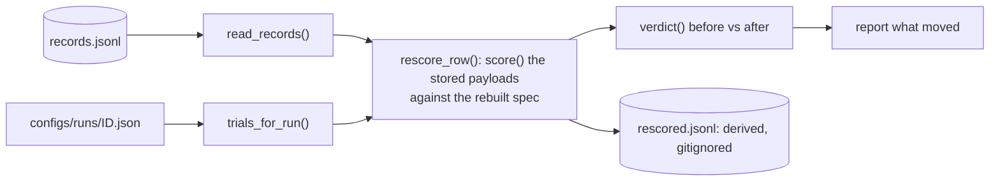

# 10 — Reading a run: `analyse.py`, `rescore.py`, `compare.py`, `logs.py`, `progress.py`

Three commands read `results/<run>/records.jsonl`, and none of them needs a GPU, a server or a
network. All three **fit nothing and drop nothing**.

```bash
scripts/analyse.sh  RUN_ID [--section …] [--json out.json]
scripts/rescore.sh  RUN_ID [--changed N] [--write]
scripts/compare.sh  a.json b.json [--json out.json]
```

---

## 1. `analyse.py`: what one run did

It reports descriptive counts, proportions and **Wilson** intervals, with no model of any kind
behind them. It uses Wilson intervals instead of the normal approximation because several cells
are close to 0 or 1, where the normal interval runs off the end of the scale.

Nothing in the module names a source, family, checker key or model, so it reads any run without
special cases. `tests/test_analyse.py::test_the_report_names_no_source_and_no_model` asserts this,
and a run whose sources are named DEV/CHAT/NOTE reports correctly.

There are ten sections, and **their order matters**, because the later ones are worthless if an
earlier one is wrong:

| Section | The question | What it guards against |
|---|---|---|
| `scoring` | were these verdicts made by the checkers installed **now**? | every record carries `checker_fingerprint`, so this costs nothing. Records written before the field existed say **UNKNOWN** instead of guessing. `SAME_SCORING` names older fingerprints whose source scores exactly as a later one |
| `hygiene` | is this **one** run? | one serving snapshot, one concurrency, truncations, faults, `stopped_by`, turns taken |
| `outcomes` | what the model did, per family, per arm, per set size | **the two arms are not comparable per trial**: a solo trial shows one option of five and a conflict shows two |
| `position` | does the later instruction win? | split three ways and never pooled |
| `sources` | does the source matter once position is held fixed? | the overall column is what a sorted design reports, and it is worth little |
| `solo` | what can the model do with nobody disagreeing? | compared **per option**, never per trial |
| `unresolved` | why a reply could not be labelled | `artifact_shaped` is the only bucket that can be **our** fault |
| `items` | which scenarios measured nothing, **by name** | names instead of counts, because a count cannot be intersected with the next run's |
| `repeats` | how much of the outcome was the draw rather than the item | |
| `communication` | did the model ever say the instructions disagreed, split by which instruction then won: the later or an earlier one, or on a tier run the policy's winner or not | |

The behaviour sections (`outcomes`, `position`, `sources`, `solo`, `repeats` and `communication`)
read usable replies only. A truncated or faulty reply stays in the log but is not behaviour
([09](09_runner_execution.md), section 3); until 2026-10-09 `position` and `sources` read its win.
`hygiene` and `scoring` read every row, because they are about the log, and so do `unresolved` and
`items`, because a truncated reply is one of the shapes they sort.

`SAME_SCORING` in `analyse.py` maps the fingerprint of source that differs from a later version
only in docstrings to that later fingerprint, and `scoring` and `compare` read the two as one
instrument. It lives outside the files the fingerprint hashes, so adding an entry does not move
today's. Its one entry is 51e74e1, which changed one docstring in `runner/run.py` and left half
the Qwen 3 main run under the older fingerprint, read as "NO" over verdicts nothing had changed.
Add an entry only after reading the diff between the two commits and finding nothing else in the
checkers or the scoring modules.

`load_rows` attaches `winner`, the source that carried the option a `chose` reply landed on. When
several sources carried that option, as in a free prediction, `winner` is `None`, so the win is left
out of the position and source tables rather than credited to whichever source came first (finding
Y of the code audit). No run so far has had such a trial.

`load_rows` works out each reply's shape as it reads the row and keeps the row without `raw`,
`later_turns` and `messages`, which with thinking on hold most of a log; the 1.7B run's report
peaks at about 120 MB (finding W of the code audit). Every reader takes
`records.jsonl.gz` where `records.jsonl` is not there, so a finished log can be compressed. `--json` always writes every section, whatever `--section`
printed.

### The three kinds of pair

This is the most important thing `analyse` does. It exists because pooling the kinds produced a
number that described nothing that happened.

```python
pair_kinds(rows) -> {"within_message": …, "free": …, "pinned": …}
```

```
 within_message   BOTH sources are in `operator_pinned`, so they are two labelled lines of ONE
                  system message.  → PRIMACY: the FIRST line wins (0.219–0.388 for the second)
 free             the order varied both ways across separate messages
                  → RECENCY: the LATER instruction wins (0.834 / 0.890 / 0.898)
 pinned           one source is always first → recency PLUS whatever being an operator costs
```

A test that only asked *"did the order vary?"* called both of the first two kinds **free**, and
averaged 0.834 with 0.260 into **0.716**. Whether both sources are pinned is what tells them apart.
It is read from the record, so it also holds for a family whose operator channel is a `developer`
message.

`position` also declines to read sets larger than a pair, because *"which one arrived later"* has
an answer for a pair and not for a triple. It reports how many draws it left out.

### `solo`, and the denominator that reads backwards

Solo ability is a property of **(scenario, option)**, so it is measured per option. Each
(scenario, option) is put in a tier (`never`, `sometimes` or `always`), and conflict wins are
broken down by tier.

The three-row table is a **mix**, and the output says so. Where *both* options are always
producible, exactly one of them wins, so that cell is close to 0.5 by construction. A better model
puts more of its conflicts in that cell, which pulls its own `always` row down as it improves: the
row went from 0.566 on the 1.7B to 0.510 on the 14B, while the 14B was better at everything else.
The cross-tabulation `conflict_win_by_both_abilities` is printed beside the table, and it is the
one to compare runs on.

`solo.has_solo_arm` is `False` for a run that sent no solo trials, such as `ladder-qwen3-14b`.
`compare` reads it (see §3).

**Nothing is ever dropped because of this.** The collection's rule is that no scenario is removed
for how one model did on it.

### `unresolved` and `items`: names, not counts

```
 never_solo       produced unopposed on no draw of this run (only runs with a solo arm)
 never_labelled   never chose in ANY arm here, with the reply shape attached:
                  empty | truncated | no_artifact | artifact_shaped
```

`reply_shape(row, key, scenario, opened)` puts an unlabelled reply in one of those four buckets.
It reads the reply through `run.answer_text(row)`, which parses every stored turn the way `score`
did and returns the turn the checker scored. `opened` is the family's
`thinking_prefills_open_block`, which `analyse()` passes down to `unresolved` and `items`.
`artifact_text` then decides between `artifact_shaped` and `no_artifact`. Until September 2026 it
read the last turn that had any text, so an artifact followed by a sign-off was counted as the
model's miss instead of ours (finding E of the code audit). On the three runs
on disk the fix changes no count.

`artifact_shaped` means the model wrote something the format gate calls an artifact and **no
classifier could label it**. Either a classifier cannot read what it was given, or the task's
honest answer is prose, and in both cases the fault is ours. The section names the scenarios
because only the intersection across runs separates *"this model could not"* from *"no model
can"*.

## 2. `rescore.py`: score a finished run again

```bash
scripts/rescore.sh RUN_ID --changed 20   # the trials whose verdict moved
scripts/rescore.sh RUN_ID --write        # writes rescored.jsonl BESIDE the log
```

`records.jsonl` keeps every completion (`raw` and `later_turns`), so a corrected checker is
re-applied to what the model actually said instead of costing a night of serving. **Rescoring
never writes to `records.jsonl`.**



`rescore_row` looks the trial id up in the specs rebuilt from today's config, and passes the stored
payloads, the stored `messages`, `stopped_by` and `attempt` to `score`. The replies and the prompt
come from the stored row, while `options_in_play`, `scenario_id` and `meta` come from the rebuilt
spec. A trial id names the scenario and the composition but not which source carried which option,
so before scoring, `rescore_row` renders the rebuilt spec and checks that the stored `messages`
open with exactly that prompt. If they do not, the row is reported and skipped like an unknown
trial id. Without the check, an edit to the design that kept the trial ids would attach today's
`carries` and `slots` to yesterday's replies without a warning (finding X of
the code audit). A row that stored no prompt cannot be checked and is scored as
before.

`verdict(row)` compares more than `(behaviour, label)`. A composite trial has neither, so
`(None, None)` compared equal, and a correction could have changed every group of every load trial
while the rescore reported that nothing had moved. It compares behaviour, label, `alternatives`
(which options a `multiple` reply gave), `communication`, conjunction, `all_satisfied`, every
group's verdict and alternatives, and every filler's result. `alternatives` and `communication`
were added after the audit (finding R): on the first run a fix turned 47 `hedged` rows `silent`, and
45 of them had been reported as not moving. A moved line printed by `--changed` shows the label, any
alternatives, and the communication.

`CARRIED = ("at", "concurrency", "tool_turns")` lists what the **run** recorded, as opposed to what
the **checkers** decided. `checker_fingerprint` is left out of that list on purpose, because it is
the one field a rescore overwrites.

A row whose trial the config no longer builds, or builds with a different prompt, is **reported
and skipped**, never guessed at.

Current state, all three runs rebuilt from their configs and rescored from `records.jsonl` with
the checkers installed at the end of September 2026:

```
 ladder-qwen3-14b     9,000 records,  0 skipped,  6 verdicts moved
 balanced-qwen3-14b   9,720 records,  0 skipped,  5 verdicts moved
 balanced-qwen3-1.7b  9,720 records,  0 skipped, 27 verdicts moved
```

The moves are the fmt-0190 fix on all three runs, the fmt-0019 fix on six 1.7B draws that were
already unusable, and on the 1.7B the 15 moves of an earlier, documented checker fix. Before the September 2026 checker changes the ladder
and the 14B rescored to 0 moves, so the scoring path is deterministic.

0 skipped on every run means `design.py` still rebuilds every trial that was sent, prompt for
prompt. That is an end-to-end consistency check across the design, the renderer, the parser and
the checkers. The first run's 1,077 records, taken from the history, also rescore with 0 skipped.

## 3. `compare.py`: two or more runs side by side

`compare` answers the questions that are about the **collection** rather than about one run.

```
 WERE THEY SCORED BY THE SAME CHECKERS?      ← read this first; EXIT 1 if not
 SIDE BY SIDE                                 numbers `analyse` already computed, nothing derived
 WHAT NO RUN COULD DO                         the intersection of the named lists
   ... OF THOSE, ARTIFACT-SHAPED EVERYWHERE   ours to fix, not the model's
```

`load_report` requires the `items`, `scoring` and `solo` sections, and tells you to re-run
`analyse` when one is missing. The command exits `0` when every run carries the same fingerprint
(or ones `SAME_SCORING` reads as one),
`1` when they differ or a run has none, and `2` when it is given one report or a file it cannot
read.

`ROWS` is a fixed list of `(label, path into the report)`. Every row is a number `analyse` already
computed, because **a quantity that exists in two places drifts in one of them**.

"Never produced unopposed" is intersected only over runs whose report says
`solo.has_solo_arm`. A run with no solo arm names no scenario as never done solo, so including it
would empty the intersection. On `balanced-qwen3-14b` against `ladder-qwen3-14b` the section used
to print "on EVERY run: 0". It now prints `-` for the ladder, and when fewer than two runs have a
solo arm it says there is nothing to intersect (`never_solo_measured_by` in the JSON lists the
runs that were used). Comparing the 1.7B, the 14B and the ladder, 91 scenarios were produced
unopposed on neither balanced run: 86 format, 3 ordering and 2 tool.

`compare` fits nothing and tests nothing. It prints "Overlapping intervals are not a test and
disjoint ones are not a result." What it produces is a reading list.

## 4. `logs.py` and `progress.py`: what a command says while it runs

**stdout is a contract, and logging is not part of it.** `scripts/serve.sh` `eval`s the output of
`serving shell KEY`, `serving gpus` is substituted into a command line, and `batch --report` prints
JSON. So every log record and every progress line goes to **stderr** and to
`logs/<tool>-<subject>-<when>.log`, and only the prints that make up a command's report go to
stdout.

```python
get_logger(__name__)   # under `python3 -m`, __name__ IS "__main__", which is not under "whowins"
                       # and reaches none of the handlers, so every module logger in a running
                       # command wrote nothing. The real dotted name is read back off __spec__.
```

`add_arguments(parser)` gives every command the same five flags (`-v`, `-q`, `--log-file`,
`--no-log-file`, `--progress`) with one meaning each, and `tests/test_logs.py` reads the parsers to
check that `runbook.md` documents every one of them.

The log file always holds **DEBUG**, whatever the terminal was asked to show. A log file that
cannot be written produces a warning and does not stop the job.

`progress.py` is a dependency-free bar on stderr:

```
Trials  ████████████▌       4,812/9,000   53%  4.2 trials/s  ETA 00:16:38  ord-0141@S3-S5
        └ 20 chars, fixed width          └ never dropped    └ dropped first: note, rate,
          + an eighths block so it                             bar, eta, label
          moves between characters
```

- **The rate counts trials, not requests.** With `tool_turns` above 1, a trial is an agent loop
  that may make several requests, so calling it req/s would overstate the rate by however many
  calls the model chose to make.
- **The estimate is read from a 120-second sliding window**, and it is not shown at all until
  there are 12 samples and 15 seconds of data. A run's first requests go out while the server is
  warming up, and an average over those under-reports the rate for hours. Withholding the early
  estimate is what keeps it accurate.
- **The line always fits.** Fields are dropped in a stated order as the terminal narrows. The
  count and the percentage are never dropped, because a bar that cannot say how far along it is no
  longer does its job.
- A log record **wipes the bar and redraws it** (`ProgressAwareHandler`), so it never lands in the
  middle of the bar.
- A redirected stream has no width, gets whole lines and keeps every field, which makes a
  redirected log readable.
- Block characters fall back to `#` and `-` on a stream that cannot encode them.

## 5. `results/` and `logs/` on disk

```
 results/<run_id>/records.jsonl   THE EVIDENCE. append-only, kept outside git
 results/<run_id>/summary.json    derived from the log alone; deleting it costs nothing
 results/<run_id>/rescored.jsonl  derived, GITIGNORED; committing one would put a second,
                                  staler answer beside the file it came from
 logs/<tool>-<subject>-<when>.log gitignored: what THIS checkout did, not what the study did
```

Records stay outside git: the repository carries the things every machine must agree about, and
`results/` is ignored. The run records are released separately. A finished thinking-arm log can
pass 100 MB, so it may be kept gzipped: every reader takes `records.jsonl.gz`.

## 6. Reading the other kinds of run

`analyse` reads any run, and groups outcomes by arm, so a load or tier run's trials stay out of the
pair and source tables. Five readers are specific to a kind of run, all offline:

| Command | Reads | Prints |
|---|---|---|
| `scripts/strengths.sh <ladder run>` | a ladder run | strengths, the composition test, THE FAMILIES |
| `scripts/strengths.sh <ladder run> --free <log>` | a ladder run and the free run of the same model and mode | the free predictions against the ladder's pair fit |
| `scripts/capacity.sh <tier run>` | a `declared-tiers-6` or `declared-tiers` run | R(q) at 0.9, 0.95 and 0.99 over the tiers it measured, lower and upper bound, the weakest pairs |
| `scripts/load_cell.sh <load run>` | a `load-bundles` run | per trial of the grid, groups chosen, all groups, fillers kept and whole task over bundles; the contrasts of conflict against length; the conjunction against independence |
| `scripts/layouts.sh <run>` | an `operator-decomposition`, `one-message` or `realism` run | each layout's rate and the contrasts that pair two layouts of one item ([17_layouts.md](17_layouts.md), section 5) |
| `scripts/pool.sh <run> <run> …` | two or more runs' pairs | strengths shared across them, the spread between models, and whether a harness was separable |

`analyse` reports a load run only by each trial's overall outcome by arm; the per-group and filler
outcomes in every record (`groups`, `fillers`, `conjunction`, `all_satisfied`) are read by
`scripts/load_cell.sh` ([16_load_bundles_and_tiers.md](16_load_bundles_and_tiers.md), section 5).
